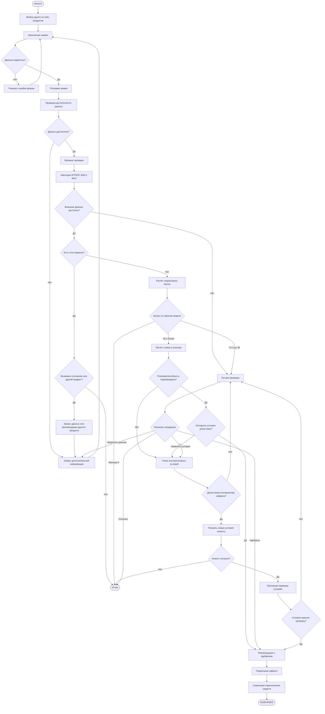

# alfa-credit-cabinet
# Умный кабинет кредитования малого и микро-бизнеса

Учебный прототип веб-сервиса для подачи и рассмотрения кредитных заявок малого и микробизнеса. Система выполняет первичные проверки, рассчитывает скоринговый балл, оценивает кредитные условия, предлагает альтернативы и отображает ход рассмотрения заявки.

> **Статус проекта:** учебный прототип. Данные ЕГРЮЛ, БКИ и ФНС имитируются с помощью синтетических тестовых данных. Реальные кредитные операции и перечисление денег не выполняются.

## Содержание

1. [Описание проекта](#1-описание-проекта)
2. [Кредитные продукты](#2-кредитные-продукты)
3. [Пользовательский сценарий](#3-пользовательский-сценарий)
4. [Блок-схема](#4-блок-схема)
5. [Статусы заявки](#5-статусы-заявки)
6. [Синтетические данные](#6-синтетические-данные)
7. [Скоринговая модель](#7-скоринговая-модель)
8. [Правила принятия решения](#8-правила-принятия-решения)
9. [Расчёт процентной ставки](#9-расчёт-процентной-ставки)
10. [Расчёт аннуитетного платежа](#10-расчёт-аннуитетного-платежа)
11. [Оценка платёжеспособности](#11-оценка-платёжеспособности)
12. [Поиск альтернативных условий](#12-поиск-альтернативных-условий)
13. [Стоп-правила](#13-стоп-правила)
14. [Пользовательский интерфейс](#14-пользовательский-интерфейс)
15. [REST API](#15-rest-api)
16. [Структура данных заявки](#16-структура-данных-заявки)
17. [Обработка ошибок](#17-обработка-ошибок)
18. [Тестирование](#18-тестирование)
19. [Ограничения проекта](#19-ограничения-проекта)

## 1. Описание проекта

Сервис автоматизирует учебную модель кредитного процесса: от подачи заявки предпринимателем до принятия решения, подписания оферты и симуляции перечисления средств.

### Цели

- Создать единый интерфейс для клиента и сотрудника банка.
- Автоматизировать проверку исходных данных заявки.
- Реализовать прозрачную математическую модель скоринга.
- Рассчитывать процентную ставку и ежемесячный платёж.
- Проверять соответствие заявки требованиям кредитного продукта.
- Формировать альтернативные предложения при невозможности одобрения первоначальных условий.
- Обеспечить отслеживание статуса и объяснение принятого решения.

### Роли пользователей

| Роль | Функциональность |
|---|---|
| Клиент | Просмотр продуктов, заполнение заявки, отправка на рассмотрение, просмотр результата, принятие или отклонение альтернативных условий, подписание оферты |
| Сотрудник банка | Просмотр заявок, изучение скоринга и результатов проверок, одобрение, изменение условий, отказ, запрос дополнительной информации |

## 2. Кредитные продукты

В проекте предусмотрены три кредитных продукта.

| Параметр | Оборотный кредит | Инвестиционный кредит | Кредит на модернизацию |
|---|---|---|---|
| Назначение | Пополнение оборотных средств, закупки, текущие расходы | Оборудование, расширение бизнеса, запуск нового направления | Модернизация предприятия, обновление оборудования и производственных процессов |
| Минимальная сумма | 100 000 ₽ | 1 000 000 ₽ | 1 000 000 ₽ |
| Максимальная сумма | 3 000 000 ₽ | 10 000 000 ₽ | 10 000 000 ₽ |
| Минимальный срок | 3 месяца | 12 месяцев | 36 месяцев |
| Максимальный срок | 24 месяца | 60 месяцев | 120 месяцев |
| Базовая годовая ставка | От 16% | От 14% | От 10% |
| Минимальный стаж компании | 6 месяцев | 12 месяцев | 12 месяцев |
| Способ погашения | Аннуитетный | Аннуитетный | Аннуитетный |

Сумма, срок и минимальный стаж должны проверяться по параметрам конкретного продукта. Система не должна применять ограничения одного продукта к другому.

## 3. Пользовательский сценарий

1. Клиент выбирает один из трёх кредитных продуктов.
2. Заполняет заявку: название компании, ИНН, сумму, срок и цель кредита.
3. Система проверяет обязательные поля, формат ИНН и допустимость суммы и срока.
4. Клиент отправляет заявку на рассмотрение.
5. Система проверяет достаточность данных и выполняет базовые проверки.
6. Система получает синтетические сведения из имитаций ЕГРЮЛ, БКИ и ФНС.
7. Проверяются стоп-правила и соответствие требованиям выбранного продукта.
8. Система рассчитывает скоринговый балл.
9. Если автоматическое одобрение допустимо, система рассчитывает итоговую ставку и аннуитетный платёж.
10. Проверяется платёжеспособность по заданным правилам проекта.
11. Система сначала проверяет, можно ли одобрить выбранный кредит на первоначальных условиях.
12. Если первоначальные условия допустимы, заявка направляется на одобрение.
13. Если первоначальные условия не подходят, система ищет допустимые альтернативы: другую сумму, срок или продукт.
14. Клиент принимает или отклоняет альтернативное предложение.
15. Если автоматического решения недостаточно, заявка передаётся сотруднику банка.
16. После одобрения клиент подписывает оферту в рамках симуляции.
17. Система имитирует перечисление средств и переводит заявку в статус `DISBURSED`.

## 4. Блок-схема



## 5. Статусы заявки

| Статус | Значение |
|---|---|
| `DRAFT` | Заявка сохранена как черновик |
| `ADEQUACY_CHECK` | Проверка достаточности данных |
| `BASE_CHECK` | Базовые проверки и стоп-правила |
| `PRODUCT_SELECTED` | Кредитный продукт выбран |
| `SCORING` | Расчёт скорингового балла |
| `ALTERNATIVES_CHECK` | Поиск альтернативных условий |
| `MANUAL_REVIEW` | Ручная проверка сотрудником |
| `NEEDS_INFO` | Требуется дополнительная информация |
| `APPROVED` | Заявка одобрена |
| `TERMS_CHANGED` | Сформировано альтернативное предложение |
| `REJECTED` | Отказ |
| `CONTRACT_SIGNING` | Подписание оферты |
| `DISBURSED` | Перечисление средств смоделировано |

Основные переходы:

- `DRAFT` → `ADEQUACY_CHECK`
- `ADEQUACY_CHECK` → `BASE_CHECK` или `NEEDS_INFO`
- `BASE_CHECK` → `SCORING`, `MANUAL_REVIEW`, `NEEDS_INFO` или `REJECTED`
- `SCORING` → `APPROVED`, `ALTERNATIVES_CHECK`, `MANUAL_REVIEW` или `REJECTED`
- `ALTERNATIVES_CHECK` → `TERMS_CHANGED`, `MANUAL_REVIEW` или `REJECTED`
- `TERMS_CHANGED` → `APPROVED`, `MANUAL_REVIEW` или `REJECTED`
- `APPROVED` → `CONTRACT_SIGNING`
- `CONTRACT_SIGNING` → `DISBURSED`

Переходы должны быть ограничены бизнес-правилами. Например, нельзя перейти к подписанию без одобрения, а к `DISBURSED` — без завершения симуляции подписания.

## 6. Синтетические данные

Реальные API ЕГРЮЛ, БКИ и ФНС не подключаются. Вместо них используются синтетические тестовые данные, позволяющие воспроизводить различные сценарии рассмотрения заявки.

| Источник | Синтетические данные | Для чего используются |
|---|---|---|
| ЕГРЮЛ | Название компании, ИНН, дата регистрации, статус деятельности, ОКВЭД | Проверка статуса компании, стажа и базового соответствия требованиям |
| БКИ | Количество действующих кредитов, долговая нагрузка, количество просрочек за 12 месяцев | Расчёт скоринга и оценка кредитного риска |
| ФНС | Выручка за последний год, наличие задолженности перед бюджетом | Расчёт финансовых показателей и выполнение стоп-проверок |

Для тестирования следует предусмотреть ситуации:

- действующая компания с достаточным стажем;
- компания с недостаточным стажем для выбранного продукта;
- высокая долговая нагрузка;
- отсутствие просрочек;
- наличие просрочек;
- задолженность перед бюджетом;
- ИНН отсутствует в тестовом наборе;
- один из имитируемых сервисов недоступен;
- первоначальные условия не подходят, но найден другой допустимый продукт.

## 7. Обработка данных

В качестве целевого показателя обучения будущих моделей было выбрано 
определять дефолт компании в горизонте 12 
месяцев. На основе анализа факторов кредитного риска 
и специфики малого бизнеса мы самостоятельно 
определяем и используем следующий набор признаков.

### 7.1. Описание признаков обучающих датасетов

- `application_id` | **ID заявки**
- `inn` | **ИНН компании**
- `business_age_months` | **Стаж компании (в месяцах)**
- `avg_monthly_revenue_12m` | **Среднемесячная выручка за 12 месяцев**
- `revenue_growth_rate` | **Темп роста выручки**
- `revenue_volatility_std` | **Волатильность выручки (стандартное отклонение)**
- `avg_monthly_expenses_12m` | **Среднемесячные расходы за 12 месяцев**
- `existing_monthly_loan_payments` | **Существующие ежемесячные платежи по кредитам**
- `delinquency_count_12m` | **Количество просрочек за 12 месяцев**
- `max_delinquency_days_12m` | **Максимальный срок просрочки за 12 месяцев**
- `requested_amount` | **Запрашиваемая сумма кредита**
- `requested_term_months` | **Запрашиваемый срок кредита (в месяцах)**
- `new_monthly_loan_payment` | **Новый ежемесячный аннуитетный платеж** | $P \cdot \frac{r(1+r)^n}{(1+r)^n - 1}$
- `net_cash_after_all_debts` | **Чистый денежный остаток после всех долгов** | `net_cash_base - new_monthly_loan_payment`
- `target_default_12m` | **Целевой признак дефолта (таргет)** | `1 if (risk_score + noise) >= threshold else 0`

Исторические и финансовые показатели компаний подтягиваются из 
mock-ов ФНС и БКИ, а параметры кредита (сумма и срок) берутся 
из поданных заявок.

Целевой показатель — дефолт (`1` — дефолт, `0` — без дефолта) 
формируется путем накопления штрафных баллов риска на основе 
финансовых ограничений и кредитной истории с добавлением 
нормального шума, что позволяет удерживать реалистичную долю 
дефолтов в выборке на уровне **15–20%**.

### 7.2. Оборотный кредит (`working_capital`)

- Остаток свободных денег (`net_cash_after_all_debts`):
  - Если остаток отрицательный или меньше нового платежа в 1.5 раза: +2 ... +5 баллов (в зависимости от глубины кассового разрыва).
- Прошлые просрочки (`delinquency_count_12m`):
  - Наличие просрочек (> 0): +3 балла.
- Длительные просрочки (`max_delinquency_days_12m`):
  - Задержки свыше 30 дней (> 30): +4 балла.
- Динамика выручки и возраст:
  - Падение выручки более чем на 5% (`revenue_growth_rate < -0.05`): +2 балла.
  - Высокая волатильность выручки: +1 балл.
  - Молодой возраст компании (от 6 до 12 месяцев): +1 балл.
- Порог для дефолта (`target_default_12m = 1`): если итоговый балл с учетом случайного шума $\ge 7.0$.

### 7.3. Инвестиционный кредит (`investment`)

- Денежный остаток:
  - Отрицательный остаток после вычета платежа: +4 балла.
  - Слабый запас прочности (< 1.3 от платежа): +2 балла.
- Просрочки в БКИ:
  - Наличие просрочек (`delinquency_count_12m > 0`): +3 балла.
  - Долгие просрочки (`max_delinquency_days_12m > 30`): +3 балла.
- Тренды:
  - Резкое падение выручки более чем на 10% (`revenue_growth_rate < -0.1`): +2 балла.
  - Высокая волатильность доходов: +1 балл.
- Порог для дефолта (`target_default_12m = 1`): если итоговый балл с учетом шума $\ge 6.3$.

### 7.4. Кредит на модернизацию (`modernization`)

- Операционная прибыль:
  - Отрицательная операционная прибыль за 12 месяцев (`total_operating_profit_12m < 0`): +4 балла.
- Денежный поток:
  - Отрицательный остаток после льготного платежа: +5 баллов.
  - Слабый запас прочности (< 1.4 от платежа): +2 балла.
- Просрочки:
  - Наличие просрочек (`delinquency_count_12m > 0`): +3 балла.
  - Долгие просрочки (`max_delinquency_days_12m > 30`): +3 балла.
- Тренды:
  - Снижение выручки более чем на 5% (`revenue_growth_rate < -0.05`): +2 балла.
- Порог для дефолта (`target_default_12m = 1`): если итоговый балл с учетом шума $\ge 7.5$.

## 8. Расчёт процентной ставки

Для каждого продукта задаётся базовая годовая ставка:

- оборотный кредит — 16%;
- инвестиционный кредит — 14%;
- кредит на модернизацию — 10%.

Ставка «от» означает базовое значение модели, а не гарантированную ставку для каждого клиента.

### 8.1. Формула итоговой ставки

Для демонстрации можно использовать следующие проектные настройки:

| Скоринговый балл | Надбавка | Действие |
|---|---:|---|
| От 55 до 70 | +0 п. п. | Допускается базовая ставка |
| От 40 до 54 | +1,5 п. п. | Допускается расчёт ставки с надбавкой |
| От 0 до 39 | Не рассчитывается автоматически | Ручная проверка |
| Меньше 0 | Не рассчитывается | Отказ |

## 9. Расчёт аннуитетного платежа

### Общая сумма выплат и переплата
...
### Допущения
- ставка фиксирована на протяжении срока;
- платежи выполняются ежемесячно;
- комиссии, страхование, штрафы и досрочное погашение не учитываются;
- точные даты платежей и банковские правила округления не моделируются.

## 10. Оценка платёжеспособности


## 11. Поиск альтернативных условий

Система ищет альтернативы только после того, как установлено, что первоначальные условия не подходят.

Возможные варианты:
- уменьшение суммы;
- увеличение срока в рамках ограничений продукта;
- выбор другого кредитного продукта;
- повторный расчёт ставки;
- повторный расчёт платежа и платёжной нагрузки.

Алгоритм:
1. Проверить сумму, срок и требования первоначального продукта.
2. Рассчитать ставку и ежемесячный платёж.
3. Проверить платёжеспособность.
4. Если первоначальные условия допустимы, не менять их автоматически.
5. Если условия недопустимы, сформировать возможные варианты.
6. Проверить каждый вариант по диапазонам суммы, срока и минимального стажа соответствующего продукта.
7. Повторно рассчитать ставку и платёж.
8. Исключить варианты, нарушающие стоп-правила.
9. Предложить допустимые условия клиенту.
10. Зафиксировать принятие или отклонение предложения.

Изменённые условия не считаются одобренными до завершения проверок и фиксации решения.

## 12. Стоп-правила

| Условие | Действие | Обоснование |
|---|---|---|
| Компания не имеет статуса «действует» в синтетических данных ЕГРЮЛ | Автоматический отказ | Не выполнено базовое требование к компании |
| Стаж меньше минимального для продукта | Отказ по выбранному продукту или рекомендация другого | Нарушено обязательное требование продукта |
| ИНН не найден в тестовом наборе | Запрос информации | Недостаточно данных |
| Есть задолженность перед бюджетом по синтетическим данным ФНС | Дополнительная проверка по правилам модели | Необходима оценка риска |
| Высокая долговая нагрузка | Снижение балла, ручная проверка или отказ согласно порогам | Повышенный риск |
| Существенные просрочки | Снижение балла, ручная проверка или отказ согласно порогам | Неблагоприятный кредитный профиль |
| Внешний имитируемый сервис недоступен | Ручная проверка | Нет полного набора данных |
| Сумма или срок за пределами продукта | Возврат к редактированию или предложение другого продукта | Нарушены ограничения продукта |

Отсутствие ответа от имитируемого сервиса само по себе не означает, что компания ненадёжна. В этом случае корректнее направить заявку на ручную проверку.

## 13. Пользовательский интерфейс

### Интерфейс клиента

**Экран 1. Выбор продукта**

Три карточки с назначением, суммой, сроком, базовой ставкой и минимальным стажем компании. Каждая карточка содержит кнопку «Подать заявку».

**Экран 2. Форма заявки**

| Поле | Тип | Проверка |
|---|---|---|
| Название компании | Текст | Обязательное |
| ИНН | Текст | В учебной форме — 10 цифр |
| Сумма кредита | Число | Диапазон выбранного продукта |
| Срок | Выпадающий список | Диапазон выбранного продукта |
| Цель кредита | Текст | Обязательное |

Кнопки: «Сохранить черновик», «Отправить на рассмотрение», «Назад к продуктам».

Проверка формата ИНН не подтверждает существование компании. Для этого используется отдельная проверка синтетического набора данных.

**Экран 3. Статус заявки**

Показываются номер заявки, компания, продукт, сумма, срок, дата создания и текущий статус.

**Экран 4. Решение**

Показываются результат, объяснение решения, итоговая ставка и расчётный платёж, если они рассчитаны.

**Экран 5. Альтернативные условия**

Клиент видит сравнение первоначальных и новых условий, а также кнопки «Принять новые условия» и «Отказаться».

**Экран 6. Дополнительная информация**

Показывается список сведений, которые необходимо уточнить. Клиент может вернуться к форме и дополнить данные.

**Экран 7. Финал**

После подписания оферты отображается сообщение о симуляции перечисления средств и итоговая сводка.

### Интерфейс сотрудника банка

**Список заявок:** ID, компания, сумма, продукт, скоринговый балл, риск-класс, статус и дата подачи. Предусмотрены фильтрация и сортировка.

**Карточка заявки:** параметры заявки, результаты синтетических проверок, баллы по каждому фактору, итоговый балл, расчёт ставки, платёж и выявленные стоп-правила.

**Действия сотрудника:**

| Действие | Результат |
|---|---|
| Одобрить | Фиксация одобрения |
| Изменить условия | Новое предложение с повторным расчётом |
| Отказать | Фиксация причины отказа |
| Запросить дополнительную информацию | Перевод в `NEEDS_INFO` |

Причина отказа и текст запроса информации должны быть обязательными полями.

## 14. REST API

Ниже приведена проектная спецификация маршрутов.

### 14.1. Клиент

| Метод | Endpoint | Назначение |
|---|---|---|
| `POST` | `/api/auth/login` | Упрощённый вход |
| `GET` | `/api/credit-products` | Список трёх кредитных продуктов |
| `GET` | `/api/credit-products/{productId}` | Детали продукта |
| `POST` | `/api/applications` | Создание заявки |
| `GET` | `/api/applications/{id}` | Просмотр заявки |
| `PATCH` | `/api/applications/{id}` | Изменение черновика |
| `POST` | `/api/applications/{id}/submit` | Отправка заявки |
| `POST` | `/api/applications/{id}/select-product` | Выбор продукта |
| `GET` | `/api/applications/{id}/alternatives` | Получение альтернатив |
| `POST` | `/api/applications/{id}/accept-terms` | Принятие альтернативы |
| `POST` | `/api/applications/{id}/decline-terms` | Отклонение альтернативы |
| `POST` | `/api/applications/{id}/sign` | Симуляция подписания оферты |

### 14.2. Системные операции

| Метод | Endpoint | Назначение |
|---|---|---|
| `POST` | `/api/applications/{id}/checks/adequacy` | Проверка достаточности данных |
| `POST` | `/api/applications/{id}/checks/base` | Базовые проверки и стоп-правила |
| `POST` | `/api/applications/{id}/scoring` | Расчёт скоринга, ставки и платежа |
| `POST` | `/api/applications/{id}/alternatives/search` | Поиск альтернатив |
| `GET` | `/api/applications/{id}/status` | Текущий статус |
| `POST` | `/api/applications/{id}/disbursement/simulate` | Симуляция перечисления средств |

### 14.3. Сотрудник банка

| Метод | Endpoint | Назначение |
|---|---|---|
| `GET` | `/api/bank/applications` | Список заявок |
| `GET` | `/api/bank/applications/{id}` | Карточка заявки |
| `POST` | `/api/bank/applications/{id}/approve` | Одобрение |
| `POST` | `/api/bank/applications/{id}/change-terms` | Изменение условий |
| `POST` | `/api/bank/applications/{id}/reject` | Отказ |
| `POST` | `/api/bank/applications/{id}/request-info` | Запрос дополнительной информации |

### Требования к API
- Проверять допустимость переходов между статусами.
- Проверять сумму, срок и минимальный стаж по выбранному продукту.
- Не разрешать подписывать неодобренную заявку.
- Не разрешать симуляцию перечисления до завершения подписания.
- Проверять права клиента и сотрудника.
- Возвращать ошибки валидации в понятном формате.
- Фиксировать историю изменения условий и решений.
- Предусмотреть защиту от повторного выполнения критичных операций.

## 15. Структура данных заявки

Пример JSON-объекта:

```json
{
  "id": "APP-0001",
  "status": "SCORING",
  "company": {
    "name": "Тестовая компания",
    "inn": "1234567890"
  },
  "credit": {
    "productId": "working_capital",
    "amount": 1000000,
    "termMonths": 12,
    "purpose": "Пополнение оборотных средств"
  },
  "scoring": {
    "score": 70,
    "riskClass": "low",
    "recommendation": "APPROVE"
  },
  "terms": {
    "baseRate": 16,
    "riskMarkup": 0,
    "finalRate": 16,
    "paymentType": "annuity"
  },
  "payment": {
    "monthlyPayment": null,
    "totalPayment": null,
    "overpayment": null
  }
}
```

## 16. Обработка ошибок


## 17. Тестирование


## 18. Ограничения проекта

| Ограничение | Обоснование |
|---|---|
| Внешние интеграции имитируются | Нет доступа к реальным API |
| Аутентификация упрощена | Прототип демонстрирует бизнес-процесс |
| Перевод денег симулируется | Реальные банковские операции не выполняются |
| Скоринг использует ограниченный набор факторов | Учебная модель, а не полноценная банковская система оценки риска |
| Ставка рассчитывается по проектным правилам | Формула надбавки является допущением прототипа |

## Итог

«Умный кабинет кредитования малого и микро-бизнеса» — учебный прототип, демонстрирующий обработку кредитной заявки от ввода данных до принятия решения и симуляции выдачи кредита.

В проекте предусмотрены три кредитных продукта, синтетические внешние данные, скоринговая модель, расчёт процентной ставки и аннуитетного платежа, проверка платёжеспособности, поиск альтернатив, интерфейсы клиента и сотрудника банка и управление статусами заявки.
